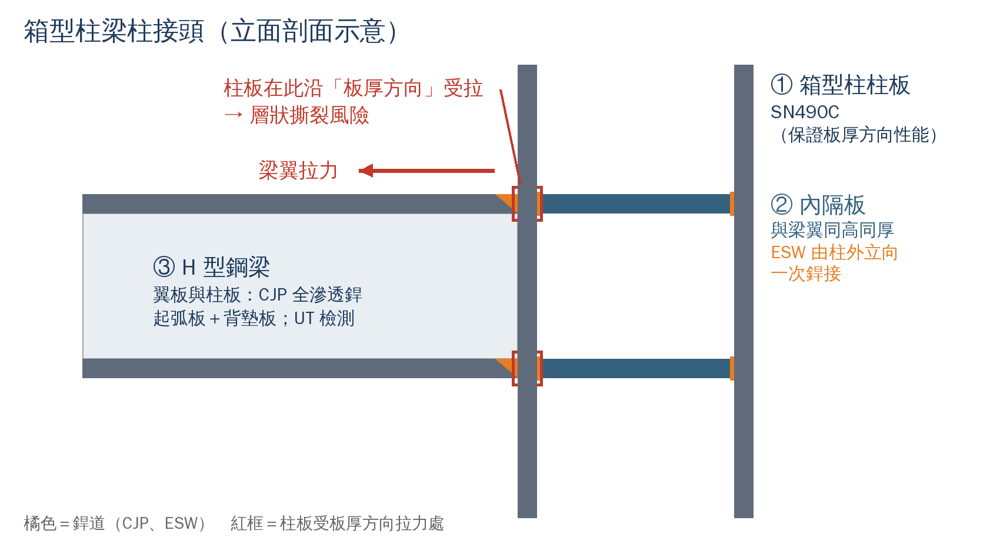

# 建築構造與施工｜弱項重點整理

> 依據：[03 80 題選擇題版](./03-115年模擬試題（80題選擇題版）.md) 作答之 12 道錯題（第 1、5、6、11、16、23、31、32、37、53、62、63 題）歸納
> 用法：§0 速記卡印出來每天看一次；§1–§5 依弱項讀完並做每節末的「自我檢測」，答案在 §6；完整詳解見 [02](./02-115年模擬試題詳解.md)、[04](./04-115年模擬試題（80題選擇題版）詳解.md)
> 證據標記同 02：✅ 已網路查證或屬規範通則｜⚠️ 待查｜💡 口訣與學習方法
> Word 列印版 → [講義/建築構造與施工_弱項重點整理.docx](../講義/建築構造與施工_弱項重點整理.docx)

---

## 0. 考前速記卡

| 主題 | 一定要記住 | 錯題 |
|---|---|---|
| CNS 3090 氯離子 | RC **新拌**混凝土 **0.30 kg/m³**（114.12.19 公告；舊值 0.15 是陷阱）；硬固混凝土不適用此表 | 1 |
| 水泥型別 | **一普、二中、三早、四低、五抗硫** | 53 |
| 施工縫 | 梁、版設在**剪力最小**的跨中 1/3；大梁與相交小梁錯開 ≥ 2 倍小梁寬 | 5 |
| 早期裂縫 | **硬化前＋沿鋼筋正上方＝塑性沉陷**；硬化前＋表面蒸發快＝塑性收縮；硬化後長期＝乾縮 | 6 |
| 模板側壓力 | **越像液體越大、凝結越快越小**（速率↑、坍度↑、振動↑、氣溫↓ → 側壓↑） | 11 |
| 營造安全數字 | 開挖 1.5 m 擋土支撐｜2 m 以上防墜｜護欄 90 cm／2.5 m／75 kg｜鋼管支柱 > 3.5 m 每 2 m 繫條｜工作台開口 > 20 cm 補網或板｜施工架 ≥ 5 m 專人設計 | 62 |
| SN 鋼材等級 | **A 不銲、B 可銲、C 再保證板厚方向**（防層狀撕裂） | 16 |
| 箱型柱接頭 | 柱板 **SN490C**＋內隔板 **ESW**（由柱外立向銲）＋銲道 **UT** | 16、63 |
| 特密管 | 管口**始終埋入**混凝土，由下而上置換穩定液 | 23 |
| 石材乾掛 | **不鏽鋼**扣件、異種金屬絕緣、背面不灌漿、扣件可吸收變位 | 31 |
| 磁磚工法 | 看砂漿塗哪：打底面＝壓貼｜**雙面＝改良式壓貼**｜磁磚背面＝積載｜打底面＋振動機＝密著 | 32 |
| 要徑法 | 列出**全部**路徑 → 加總 → **取最大**＝最短工期 | 37 |
| 題型 | 「何者**錯誤**」先圈題幹、逐項標 ○✗；「為加快…即可、無須、一律」常是錯誤選項的訊號 | 23、31 |

---

## 1. 混凝土（錯 4 題：1、5、6、53）

### 1.1 CNS 3090 氯離子新制（第 1 題）

| 項目 | 內容 |
|---|---|
| 公告 | 經濟部 114 年 12 月 19 日（經授標字第 11453001870 號） |
| 修訂內容 | 表 7：鋼筋混凝土之**新拌混凝土**最大水溶性氯離子含量 **0.15 → 0.30 kg/m³** |
| 參考與理由 | 參考 JIS A5308:2024；配合 2050 淨零排放與循環經濟 |
| 適用範圍 | 備考增列：**硬固混凝土**之限值**不適用**本表 → 不能拿來判定既有建物（海砂屋） |
| 檢測方法 | 新拌混凝土氯離子：CNS 13465 |
| 相關規定 | 預力混凝土不得使用含氯化物之摻料，如氯化鈣早強劑（第 54 題） |

- 易錯：選了舊值 0.15；把新拌混凝土的限值套用到硬固混凝土。
- 可能考法：「依 114 年修訂之 CNS 3090…」的數值題；「下列敘述何者正確」考硬固混凝土不適用。✅

### 1.2 卜特蘭水泥型別（第 53 題）

| 型別 | 特性 | 什麼情境選它 | 口訣 |
|---|---|---|---|
| 第 I 型 | 普通 | 一般結構 | 一普 |
| 第 II 型 | 中度抗硫酸鹽、中度水化熱 | 一般地下構造、較大斷面 | 二中 |
| 第 III 型 | 早強 | 趕工、寒冷氣候、預鑄 | 三早 |
| 第 IV 型 | 低熱 | 巨積混凝土（大型基礎、壩體） | 四低 |
| 第 V 型 | 高抗硫酸鹽 | 硫酸鹽土壤、地下水環境 | 五抗硫 |

- 卜作嵐材料：飛灰、爐石粉 → 降低水化熱、提升耐久性、減碳；矽灰 → 高強度、低滲透。
- 情境反推：巨積混凝土不可用第 III 型（第 4 題）；硫酸鹽環境用第 V 型；低碳用卜作嵐材料取代或卜特蘭石灰石水泥（第 39 題）。✅

### 1.3 施工縫位置（第 5 題）

| 位置 | 剪力 | 能否設施工縫 |
|---|---|---|
| 支承（柱面）附近 | 最大 | ✗ 避免 |
| 距支承約 1/4 跨 | 仍大（彎矩反曲點附近） | ✗ 第 5 題的陷阱 |
| 跨中 1/3 | 最小 | ✓ 梁、版施工縫設此 |

- 原理：施工縫是新舊混凝土的弱面，傳遞剪力的能力最差，所以看**剪力**、不看彎矩。
- 其他規則：大梁施工縫與相交小梁錯開 ≥ 2 倍小梁寬；柱施工縫設於樓版（梁）底面或樓版頂面。
- 續澆處理：去除浮漿（laitance）、打毛、清潔濕潤或塗接著劑；地下室外牆與底版之施工縫加止水帶或遇水膨脹止水條。✅

### 1.4 混凝土裂縫判斷（第 6 題）

| 類型 | 發生時間 | 形狀與位置 | 成因 | 對策 |
|---|---|---|---|---|
| 塑性收縮 | 硬化前（數小時） | 表面短而不規則 | 表面水分蒸發快於泌水（風大、日曬、高溫） | 遮陽擋風、噴霧、及早養護 |
| **塑性沉陷** | 硬化前（數小時） | **沿上層鋼筋、與鋼筋平行** | 混凝土下沉被鋼筋擋住 | 降低坍度與泌水、確保保護層、再振動或鏝壓 |
| 乾燥收縮 | 硬化後數週至數月 | 牆版貫穿、開口角隅斜裂 | 水分散失、體積收縮受束制 | 降低單位用水量、設伸縮縫、確實養護 |
| 溫度裂縫 | 硬化後數天（巨積混凝土） | 表面裂或貫穿 | 水化熱造成內外溫差 | 低熱水泥、卜作嵐材料、預冷、保溫養護 |
| 鹼骨材反應 | 數年 | 網狀（龜甲狀）＋膠體滲出 | 活性矽質骨材＋鹼 | 非活性骨材、低鹼水泥、卜作嵐材料 |
| 鋼筋腐蝕 | 數年 | 沿鋼筋、鏽水、保護層剝落 | 中性化、氯離子 | 足夠保護層、管控氯離子 |

- 💡 判斷三步：**時間**（硬化前或後）→ **形狀**（短亂、沿鋼筋、網狀）→ **位置**（表面、鋼筋上方、角隅）。

### 自我檢測：混凝土

**1.** 依 114 年修訂之 CNS 3090，鋼筋混凝土新拌混凝土之最大水溶性氯離子含量為多少？此值可否用來判定既有建物的硬固混凝土？

**2.** 大型筏基巨積混凝土宜選第幾型水泥？受硫酸鹽侵蝕的地下構造呢？

**3.** 梁的施工縫為什麼設在跨中 1/3，而不是彎矩為零的反曲點？

**4.** 澆置後 3 小時，版面沿鋼筋出現平行裂縫，是哪一種裂縫？該怎麼補救？

---

## 2. 模板與施工安全（錯 2 題：11、62）

### 2.1 模板側壓力（第 11 題）

| 因素 | 變化 | 側壓力 | 為什麼 |
|---|---|---|---|
| 澆置速率 | 加快 | ↑ | 下層還沒凝結，液柱變高 |
| 坍度（流動性） | 增大 | ↑ | 更接近液體 |
| 內部振動 | 加強、深入 | ↑ | 振動使混凝土重新液化 |
| 氣溫 | 降低 | ↑ | 凝結變慢 |
| 氣溫 | **升高** | **↓** | 凝結變快，下部已可自立（第 11 題正解） |
| 單位重 | 增加 | ↑ | 液壓與單位重成正比 |
| 自充填混凝土（SCC） | — | 以**全液壓**檢討 | 流動性極高 |

- 💡 口訣：**越像液體越大、凝結越快越小**。✅（ACI 347）

### 2.2 營造安全數字卡（第 62 題）

| 數字 | 規定 | 題號 |
|---|---|---|
| 1.5 m | 露天開挖垂直深度達 1.5 m 以上，原則上應設擋土支撐 | 14 |
| 2 m | 高度 2 m 以上之屋頂、開口、樓梯、工作台、施工構台等，有墜落之虞 → 護欄、護蓋或安全網；設置困難時使用安全帶等 | — |
| 90 cm／2.5 m／75 kg | 護欄上欄杆高 ≥ 90 cm；鋼管杆柱間距 ≤ 2.5 m；上欄杆任一點任一方向加 75 kg 無顯著變形 | 15 |
| 前方 2 m | 護欄前方 2 m 範圍內之樓板不得堆放物料 | 15 |
| 3.5 m／2 m | 可調鋼管支柱高度 > 3.5 m，高度每 2 m 內設縱、橫向水平繫條 | 13 |
| **20 cm** | 2 m 以上施工架工作台應滿鋪密接板料；與構造物間開口 > 20 cm 時加設安全網或補助板料 | **62** |
| 5 m | 高度 ≥ 5 m 之施工架，由專任工程人員或指定專人設計並繪製施工圖說 | — |
| 34°／40 cm | 斜度 > 34° 或滑溜之屋頂作業，設護欄及寬度 ≥ 40 cm 之工作臺 | — |

- 💡 口訣：「**一點五開挖、二米防墜、九十護欄、二十補縫、五米設計**」。
- 依據：✅ 營造安全衛生設施標準（2026-11 網路查證：勞動部與地方政府之檢查指引）；條次與文字以現行版為準。

### 2.3 模板支撐與拆模（同主題，已答對）

- 可調鋼管支柱：調整高度用制式金屬配件，不得以鋼筋替代；底部置於堅實基礎並防滑動（第 13 題）。
- 拆模：側模不承載可先拆；底模與支撐待混凝土達設計所需強度，以強度判定而非天數（第 60 題）。
- 系統模板：鋁模適合重複性高的標準層（第 12 題）；滑動模板用於筒倉、核心筒等連續垂直澆置（第 61 題）。

### 自我檢測：模板與施工安全

**5.** 下列何者會使模板側壓力變小：(a) 加快澆置 (b) 提高坍度 (c) 氣溫升高 (d) 加強振動？

**6.** 填空：開挖 ＿＿＿ m 設擋土支撐；護欄上欄杆 ≥ ＿＿＿ cm；工作台開口 > ＿＿＿ cm 加設安全網或補助板料；施工架 ≥ ＿＿＿ m 須專人設計。

---

## 3. 鋼構造：箱型柱接頭專題（錯 2 題：16、63）

### 3.1 一個接頭、三個考點



- ① 箱型柱柱板：**SN490C**。梁翼板拉力要**穿過柱板（板厚方向）**才傳得到內隔板，柱板沿板厚方向受拉 → 易層狀撕裂（第 16 題）。
- ② 內橫隔板：設在梁翼板對應高程、與梁翼板同厚；柱內封閉，人進不去，以**電熱熔渣銲（ESW）由柱外立向一次銲接**（第 63 題）。
- ③ H 型鋼梁：翼板與柱板全滲透開槽銲（CJP），兩端加起弧板，下翼板背墊板移除後清根補銲；銲道內部缺陷以 **UT** 檢測（第 17 題）。

### 3.2 鋼材規格：SS／SM／SN

| 規格 | 名稱 | 等級意義 | 適用 |
|---|---|---|---|
| SS400 | 一般結構用軋鋼料（CNS 2473） | 未規定碳當量 | 不需銲接或次要構件 |
| SM400／490／570（A·B·C） | 銲接結構用軋鋼料（CNS 2947） | A→C 衝擊韌性要求遞增 | 一般銲接構件 |
| SN400／490（**A·B·C**） | 建築結構用軋鋼料（CNS 13812） | **A 不銲**（次要構材）｜**B 可銲**（主要構材，控制碳當量與降伏比）｜**C＝B＋板厚方向斷面收縮率**（防層狀撕裂） | 建築主結構；C 級用於板厚方向受大拉力處 |

- 💡 口訣：**SS 不管銲、SM 可銲、SN 建築專用（A 不銲、B 可銲、C 加板厚）**。
- 依據：✅ 2026-11 網路查證（SN 等級之用途區分見 JIS G3136 母規格與鋼廠資料）；⚠️ 碳當量、斷面收縮率之數值以 CNS 13812 原文為準。

### 3.3 銲接方法

| 方法 | 特徵 | 典型用途 |
|---|---|---|
| 被覆電弧銲（SMAW，手銲） | 設備簡單、可全姿勢 | 現場銲接、修補 |
| 氣體遮護電弧銲（GMAW、CO₂ 半自動） | 效率高；遮護氣體怕風 | 工廠與現場之梁柱接頭 |
| 潛弧銲（SAW） | 自動化、熔積量大、品質佳；限平銲 | 厚板長直銲道（如箱型柱四角、組合 H 型鋼） |
| **電熱熔渣銲（ESW）** | **立向一次銲完**、入熱量大 | **箱型柱內隔板** |
| 點銲（電阻銲） | 加壓通電、熔融量小 | **薄鋼板**搭接 |
| 栓釘銲 | 專用銲槍 | 剪力釘（合成樓版） |

- ESW 的品質風險：入熱量大 → 熱影響區韌性下降；銲道或梁翼偏心、細微瑕疵，可能使接頭在發揮韌性前脆性破壞 → 控制銲接參數並以 UT 檢測。✅（2026-11 網路查證：國內箱型柱 ESW 研究）

### 3.4 銲接品質（同主題，已答對）

- 預熱：降低冷卻速率 → 減少熱影響區硬化與氫致冷裂（第 19 題）。
- 起弧板：起弧、收弧缺陷落在構材外，銲完切除磨平（第 65 題）。
- 非破壞檢測：UT（內部缺陷）、MT（表面與近表面，限鐵磁性）、PT（表面開口）、RT（內部體積型，輻射管制）、VT（外觀）（第 17 題）。

### 自我檢測：鋼構造

**7.** 為什麼箱型柱柱板在內隔板位置會有層狀撕裂風險？要選哪一種鋼材？

**8.** 箱型柱內隔板為什麼不能用一般手銲？常用哪一種銲接方法？它有什麼品質風險？

---

## 4. 外牆與基礎（錯 3 題：23、31、32）

### 4.1 磁磚張貼工法（第 32 題）

| 工法 | 張貼砂漿塗在哪 | 特點 |
|---|---|---|
| 壓貼法 | 僅打底面 | 可張貼時間短，超時易黏著不良 |
| **改良式壓貼法** | **打底面＋磁磚背面（雙面）** | 黏著率高，外牆常用 |
| 積載貼法 | 僅磁磚背面，由下往上逐片 | 傳統工法，背面易留空隙 |
| 改良式積載貼法 | 先打底，再於磁磚背面塗砂漿 | 改善積載法之黏著 |
| 密著貼法 | 打底面，以振動機將磁磚壓入 | 適用中小口磚 |

- 💡 判斷只看「砂漿塗在哪」：打底面＝壓貼；雙面＝改良式壓貼；磁磚背面＝積載；打底面＋振動機＝密著。
- 相關：伸縮縫須貫通打底層並與結構伸縮縫對齊（第 74 題）；空鼓檢測用敲擊、紅外線熱影像，黏著強度用拉拔試驗。✅

### 4.2 石材：乾掛與濕式（第 31 題）

| 項目 | 乾掛（乾式） | 濕式（灌漿） |
|---|---|---|
| 固定方式 | 扣件＋鍍鋅鋼骨架，各片獨立受力 | 背面灌水泥砂漿黏結 |
| 白華 | 少（背面不灌漿） | 易發生 |
| 層間變位、溫度伸縮 | **扣件可吸收**（第 31 題 (C) 是正確敘述） | 難吸收，易開裂、剝落 |
| 金屬材質 | 扣件用**不鏽鋼**（一般 SUS304，沿海 SUS316）；異種金屬接觸加**絕緣墊片** | — |
| 接縫 | 低汙染中性矽利康或開放縫 | 砂漿勾縫 |

### 4.3 連續壁與特密管（第 23 題）

- 施工順序：導溝 → 穩定液（皂土液）護壁 → 單元挖掘與垂直度檢測 → 吊放鋼筋籠 → **特密管澆置** → 接頭處理。
- 特密管原則：管口**始終埋入**已澆置混凝土中（依規範之最小埋入深度），由下而上連續澆置，以新混凝土把穩定液推擠出去；**不可**提出管口讓混凝土自由落下，否則會夾泥、形成斷層與漏水路徑。
- 穩定液的功能是護壁（泥膜）、液壓平衡、懸浮土砂，與混凝土強度無關（第 67 題）。✅

### 自我檢測：外牆與基礎

**9.** 「打底面與磁磚背面都塗張貼砂漿」是哪一種工法？「只塗磁磚背面、由下往上貼」呢？

**10.** 石材乾掛的扣件應採什麼材質？與鋁框接觸時要注意什麼？

**11.** 特密管管口為什麼不能提出混凝土面？

---

## 5. 題型與計算技巧（錯 3 題：23、31、37）

### 5.1 「何者錯誤」題

- 先把題幹的「錯誤／正確／不適當／非」圈起來。
- 四個選項逐一標 ○✗，只有一個 ✗ 時才作答；若出現兩個 ✗，回頭重讀題幹。
- 💡 錯誤選項的常見訊號：「為加快進度／為便利…即可」「無須」「一律」「任意」「愈…愈好」這類為了省事而偷工的敘述（第 23 題 (D)、26 題 (A)、31 題 (D)、46 題 (B) 都是），但仍須逐項判斷。
- 優點型敘述（例如「扣件可吸收層間變位」）通常是正確敘述，不要誤選為錯誤選項。

### 5.2 新制題：舊值陷阱

- 修訂後的新值才是答案，修訂前的舊值幾乎一定會放在選項裡（第 1 題：新 0.30、舊 0.15）。
- 準備方法：近一年修訂的規範，各記「改了什麼、舊值、新值、適用範圍」四件事。

### 5.3 要徑法計算（第 37 題）

```text
A(3) --+-- B(5) --- D(6) --+
       |                   +-- F(2)
       +-- C(4) --- E(8) --+
```

| 路徑 | 計算 | 工期 |
|---|---|---|
| A→B→D→F | 3＋5＋6＋2 | 16 |
| A→C→E→F | 3＋4＋8＋2 | **17（要徑）** |

- 步驟：①列出全部路徑 ②逐條加總 ③取最大＝最短工期 ④浮時＝要徑工期－該路徑工期（本題 B、D 浮時 1 天）。
- 觀念：要徑是最長路徑，總浮時為零，可能不只一條（第 79 題）。✅

### 自我檢測：題型與計算

**12.** 若第 37 題的 D 改為 8 天，最短工期與要徑為何？哪些作業有浮時？

---

## 6. 自我檢測解答

1. 0.30 kg/m³；不行，備考明定硬固混凝土之限值不適用本表。
2. 巨積混凝土用第 IV 型（低熱）或第 II 型（中熱），並以飛灰、爐石粉取代部分水泥；受硫酸鹽侵蝕用第 V 型（高抗硫酸鹽）。
3. 施工縫是新舊混凝土的弱面，傳遞剪力的能力最差，要設在剪力最小處；反曲點的彎矩雖為零，剪力仍大。
4. 塑性沉陷裂縫；趁混凝土初凝前再振動或鏝壓使其閉合，之後確實養護，並檢討坍度、泌水與保護層。
5. (c) 氣溫升高。
6. 1.5、90、20、5。
7. 梁翼板的拉力必須穿過柱板才傳到內隔板，柱板沿板厚方向受拉，鋼板中沿軋延方向分布的非金屬夾雜物（如硫化物）容易造成層狀撕裂；選 SN490C（保證板厚方向斷面收縮率、低硫）。
8. 內隔板被四面柱板封閉，人無法進入柱內施銲；以電熱熔渣銲（ESW）由柱外立向一次銲接；入熱量大使熱影響區韌性下降，偏心或瑕疵易導致脆性開裂，須以 UT 檢測。
9. 改良式壓貼法；積載貼法。
10. 不鏽鋼（一般 SUS304，沿海 SUS316）；鋁、不鏽鋼、鍍鋅鋼接觸處加絕緣墊片，防止電位腐蝕。
11. 管口一離開混凝土面，穩定液與泥渣就會混入，形成夾泥、斷層與漏水路徑。
12. A→B→D→F＝3＋5＋8＋2＝18 天，成為要徑，最短工期 18 天；A→C→E→F＝17 天，C、E 浮時 1 天。

---

## 7. 考前一週複習安排（建議）

| 天 | 內容 | 時間 |
|---|---|---|
| 1 | §1 混凝土（錯最多，最優先）＋自我檢測 1–4 | 60 分鐘 |
| 2 | §2 模板與安全數字卡（抄寫一次）＋自我檢測 5–6 | 40 分鐘 |
| 3 | §3 箱型柱接頭（自己畫一次接頭圖，標出三個考點）＋自我檢測 7–8 | 40 分鐘 |
| 4 | §4 外牆與基礎＋§5 題型技巧＋自我檢測 9–12 | 40 分鐘 |
| 5 | 不看詳解重做 12 道錯題；再計時重寫 01 原卷第 1–40 題 | 60 分鐘 |
| 6 | 02 詳解的加練申論任選 2 題（每題 35 分鐘） | 70 分鐘 |
| 7 | 只看 §0 速記卡與錯題對照 | 20 分鐘 |

---

## 8. 可信度與待查

| 項目 | 狀態 | 說明 |
|---|---|---|
| CNS 3090 氯離子新制 | ✅ 2026-11 網路查證 | 經濟部 114.12.19 公告 |
| 營造安全數字（1.5 m、2 m 防墜、90 cm、2.5 m、75 kg、3.5／2 m、20 cm、5 m、34°／40 cm） | ✅ 2026-11 網路查證 | 勞動部與地方政府檢查指引；條次與文字以現行版為準 |
| SN 鋼材 A／B／C 之用途區分 | ✅ 2026-11 網路查證 | JIS G3136 母規格與鋼廠資料；⚠️ 數值限值以 CNS 13812 原文為準 |
| ESW 用於箱型柱內隔板及其高入熱風險 | ✅ 2026-11 網路查證 | 國內箱型柱 ESW 研究 |
| 水泥型別、裂縫類型、側壓力、施工縫、銲接方法 | ✅ 規範與教科書通則 | 與 ACI 318／347／224、AWS D1.1 及國內規範一致 |
| 口訣、錯誤選項訊號、一週安排 | 💡 | 學習方法，非規定 |
