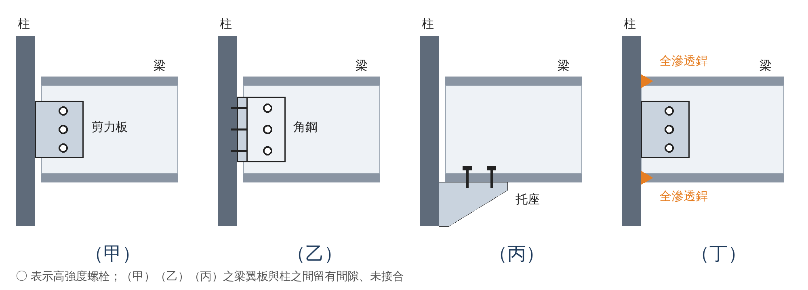
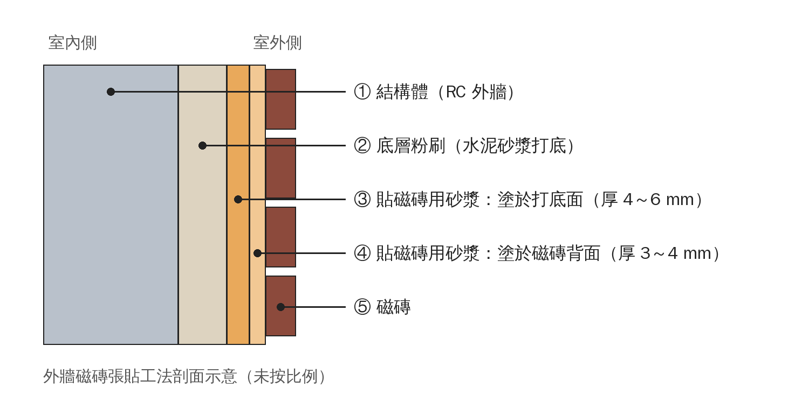
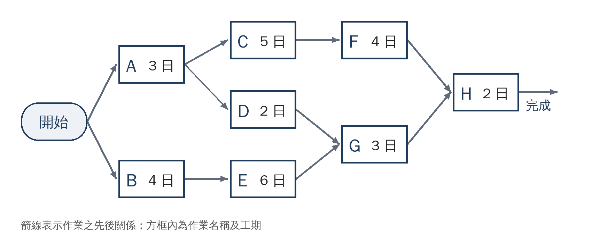

# 115 年建築師「建築構造與施工」第二回模擬試題（考前預測卷）

> 型態比照正式考試：**80 題單一選擇題、每題 1.25 分、考試時間 2 小時、禁止使用電子計算器**
> 配題依據：考選部 108–114 年原卷 560 題之主題比重、題號位置與問法（約六成為「何者錯誤」題），並加重你的弱項；分析見 [08 詳解 §2](./08-115年第二回模擬試題詳解.md)
> 這是 AI 依趨勢推估的預測卷，**不是洩題、也不保證命中**；題目多改寫自歷屆考點，詳解逐題附歷屆出處
> 解答 → [08 第二回詳解](./08-115年第二回模擬試題詳解.md)｜Word 列印版 → [講義/建築構造與施工_115第二回模擬試題.docx](../講義/建築構造與施工_115第二回模擬試題.docx)

---

## 作答規則

- 計時 **120 分鐘**，不使用計算器；建議 100 分鐘作答、20 分鐘檢查。
- 先圈出題幹的「錯誤／不適當／不包括／非」再作答；複選不計分。
- 答案填入文末答案卡，或直接把 80 個字母依序傳給我對答案。

---

```text
115 年專門職業及技術人員高等考試建築師考試（第二回模擬）
類　科：建築師
科　目：建築構造與施工
考試時間：2 小時
※注意：本試題為單一選擇題，請選出一個正確或最適當答案。
　　　　本科目共 80 題，每題 1.25 分。
　　　　禁止使用電子計算器。
```

## 測驗題（共 80 題）

**1.** 依現行國家標準對陶瓷面磚吸水率之分類，下列敘述何者正確？

- (A) Ia 類（瓷質）之吸水率為 3% 以下
- (B) 吸水率 8% 之面磚屬 II 類（石質）
- (C) III 類（陶質）之吸水率為 25% 以下
- (D) 吸水率由大至小依序為瓷質、石質、陶質

**2.** 有關建築用玻璃之敘述，下列何者錯誤？

- (A) 膠合玻璃係兩片以上玻璃以中間膜全面接著而成，破裂時大部分碎片不致飛散
- (B) 強化玻璃係將板玻璃加熱後急速冷卻，使表面形成壓縮應力層，耐衝擊強度約為普通玻璃之 3～4 倍
- (C) 色板玻璃係於玻璃原料中添加著色劑製成，可作為吸熱玻璃
- (D) 陽台欄杆使用強化玻璃時，應先強化後再依現場尺寸裁切與鑽孔

**3.** 混凝土硬化後因水分散失而產生乾縮裂縫，下列何者不是加劇乾縮之原因？

- (A) 骨材用量較多、單位水泥漿量較少
- (B) 單位用水量過多
- (C) 水灰比過大
- (D) 坍度過大且提早乾燥

**4.** 經濟部於 114 年 12 月公告修訂 CNS 3090「預拌混凝土」之氯離子含量規定，下列敘述何者正確？

- (A) 鋼筋混凝土之新拌混凝土最大水溶性氯離子含量由 0.30 kg/m³ 加嚴為 0.15 kg/m³
- (B) 修訂後之限值可直接作為既有建築物硬固混凝土之判定標準
- (C) 鋼筋混凝土之新拌混凝土最大水溶性氯離子含量修訂為 0.30 kg/m³，且硬固混凝土之限值不適用該表
- (D) 修訂後預力混凝土得使用含氯化鈣之早強劑

**5.** 薄層綠化屋頂之構造層包含：①阻根層 ②介質層 ③排（蓄）水層 ④過濾層 ⑤防水層 ⑥植栽層，由下而上之排列順序何者正確？

(A) ⑤③①④②⑥　(B) ①⑤③④②⑥　(C) ⑤①③④②⑥　(D) ⑤①④③②⑥

**6.** 依建築技術規則有關不燃材料與耐燃材料之規定，下列敘述何者錯誤？

- (A) 木絲水泥板及耐燃石膏板屬不燃材料（耐燃一級）
- (B) 混凝土、磚、陶瓷品及玻璃屬不燃材料
- (C) 耐火板係指符合耐燃二級之材料
- (D) 耐燃合板及耐燃纖維板屬耐燃材料（耐燃三級）

**7.** 有關建築石材及其外牆飾面工法，下列敘述何者錯誤？

- (A) 花崗石石質堅硬，可用於地板及牆面之內外裝修
- (B) 濕式工法較容易出現白華現象
- (C) 乾式工法之耐震性通常優於濕式工法
- (D) 大理石耐酸性佳，最適合作為外牆飾面材

**8.** 建築施工圖標示「6063-T5」之材料，以及金屬帷幕外牆耐候性較佳之表面處理，下列組合何者正確？

- (A) 不鏽鋼板；陽極處理
- (B) 鋁擠型；氟碳烤漆
- (C) 鋁擠型；一般調合漆
- (D) 熱浸鍍鋅鋼板；氟碳烤漆

**9.** 有關混凝土材料性質之敘述，下列何者錯誤？

- (A) 使用輸氣劑可同時提高混凝土之抗壓強度與抗凍性
- (B) 澆置後數小時內沿上層鋼筋位置出現之平行裂縫，多屬塑性沉陷裂縫
- (C) 高爐石混凝土之單位體積質量較普通混凝土稍低
- (D) 高性能混凝土具高流動性與高水密性

**10.** 下列卜特蘭水泥之選用，何者最不適當？

- (A) 巨積混凝土選用低熱（第 IV 型）水泥，或以飛灰、爐石粉取代部分水泥
- (B) 受硫酸鹽侵蝕之地下構造選用第 V 型水泥
- (C) 為降低水化熱，大型筏式基礎選用第 III 型水泥
- (D) 因工期需要提早拆模之工程選用早強水泥

**11.** 有關建築物之地基調查，下列敘述何者錯誤？

- (A) 供公眾使用之建築物位於砂土層有土壤液化之虞者，應辦理基地地層之液化潛能分析
- (B) 原則上基地面積每 600 平方公尺或建築物基礎所涵蓋面積每 300 平方公尺，應設一處調查點
- (C) 淺基礎基腳之調查深度應達基腳底面以下至少 4 倍基腳寬度，或達可確認之承載層深度
- (D) 同一基地之調查點數不得少於五處

**12.** 有關基地開挖與擋土措施，下列敘述何者正確？

- (A) 高地下水位且透水性良好之砂質地層，最適合採用邊坡式開挖
- (B) 鋼板樁具良好之水密性，可用於建築、水岸及堤防工程
- (C) 鋼板樁強度大，建築工程常用於深度 30 公尺之永久性擋土壁
- (D) 採用邊坡式（斜坡式）開挖時，首要檢討項目為開挖底面之隆起與砂湧

**13.** 有關連續壁施工及以特密管澆置水中混凝土，下列敘述何者錯誤？

- (A) 混凝土若於水中自由落下會嚴重析離，澆置前應於特密管底端裝設底蓋或套管塞
- (B) 特密管流出之混凝土橫向流動距離過長會降低品質，每支特密管之澆置面積應予限制
- (C) 澆置中為加速置換穩定液，可將特密管底端提出混凝土面後再行澆置
- (D) 連續壁鋼筋籠常於籠內銲接斜向鋼筋，以提升吊放時之剛度

**14.** 有關綠建材之敘述，下列何者錯誤？

- (A) 生態綠建材係指大量運用人工合成材料、無匱乏疑慮之建材
- (B) 健康綠建材具低甲醛及低揮發性有機物質逸散量之性能
- (C) 再生綠建材由廢棄材料回收再生產，可對應二氧化碳減量與廢棄物減量之要求
- (D) 綠建材標章分為生態、健康、再生及高性能四類

**15.** 有關建築物碳排放及我國低碳建築評估系統（LEBR），下列敘述何者錯誤？

- (A) LEBR 鎖定建築物之蘊含碳排，使用階段之碳排則以建築能效評估系統（BERS）評估與標示
- (B) 蘊含碳排主要發生於建築物使用階段之空調與照明耗電
- (C) 合理之結構系統設計（如均勻跨距）為建築減碳設計之重要因子
- (D) 在相同規模、格局與結構斷面尺寸之條件下，木構造較 SRC 構造低碳

**16.** 有關結構用木材之選用，下列敘述何者錯誤？

- (A) 結構用木材應採用乾燥木材，平均含水率在 19% 以下
- (B) 木材之乾縮率以弦向最大、徑向次之、纖維方向最小
- (C) 心材較邊材不易收縮翹曲，耐久性較高
- (D) 樹齡 20 年以下之木材強度大且變異性低，最適合作為主要結構材

**17.** 依建築技術規則建築構造編，一般情況下木構造建築物之簷高及樓層數限制為何？

- (A) 簷高不得超過 14 公尺，且不得超過 4 層樓
- (B) 簷高不得超過 12 公尺，且不得超過 3 層樓
- (C) 簷高不得超過 17 公尺，且不得超過 5 層樓
- (D) 簷高不得超過 21 公尺，且不得超過 7 層樓

**18.** 某木構造建築物之梁柱須具 1 小時防火時效，擬以燃燒炭化深度設計其斷面。若所選集成材之炭化速率為 0.7 mm/min，則各受火面所需考慮之炭化深度為多少？

(A) 21 mm　(B) 35 mm　(C) 42 mm　(D) 70 mm

**19.** 依建築技術規則建築設計施工編，有關防火門之規定，下列敘述何者錯誤？

- (A) 常時關閉式防火門應免用鑰匙即可開啟，並裝設開啟後可自行關閉之裝置
- (B) 常時關閉式防火門不得裝設門止，門扇或門樘上應標示常時關閉式防火門等文字
- (C) 防火門周邊 15 公分範圍內之牆壁，應以不燃材料建造
- (D) 常開式防火門採用防火捲門者，應附設門扇寬度 60 公分以上、高度 150 公分以上之防火門

**20.** 依建築技術規則，下列何種牆壁構造具有 2 小時以上之防火時效？

- (A) 厚度 7 公分之鋼筋混凝土造牆壁
- (B) 厚度 10 公分之鋼筋混凝土造牆壁
- (C) 厚度 7 公分之磚造牆壁
- (D) 鋼骨造而雙面覆以鐵絲網水泥粉刷，其單面厚度 3 公分者

**21.** 有關鋼構造高強度螺栓之施工，下列敘述何者錯誤？

- (A) 螺栓群之鎖緊應由接合部外側向中央依序進行
- (B) 螺牙不得有損傷，已使用過之螺栓不得再使用
- (C) 螺栓不得鎚擊入孔，必要時得以鉸孔方式擴孔
- (D) 扭剪型高強度螺栓以尾部（梅花頭）扭斷脫離判定已鎖緊

**22.** 有關結構用鋼材之敘述，下列何者錯誤？

- (A) 具耐震能力之結構用鋼材宜具備低降伏比與高衝擊韌性
- (B) 鋼材降伏強度愈高，伸長率趨於愈低
- (C) 符合 CNS 之 SS 系列鋼材可作為銲接主要結構之用
- (D) 箱型柱內隔板處之柱板承受板厚方向拉力，宜選用具高板厚方向斷面縮率之鋼材

**23.** 有關鋼結構之銲接及其檢驗，下列敘述何者正確？

- (A) 填角銲之安全性高於全滲透開槽銲
- (B) 銲道內部缺陷最常以磁粒檢測（MT）檢查
- (C) 箱型柱之內橫隔板與柱板通常以點銲接合
- (D) 銲條使用前預熱烘乾，主要目的為防止銲道發生裂縫

**24.** 有關鋼骨鋼筋混凝土（SRC）構造，下列敘述何者錯誤？

- (A) 矩形斷面之 SRC 構材至少應於斷面四個角落各配置一根主筋
- (B) 主筋與鋼骨應以緊貼配置為原則，以有效傳遞兩者間之應力
- (C) 梁柱接頭鋼筋過密、混凝土澆置不易時，得先澆置柱至梁底以下，俟配置梁版鋼筋後再續澆
- (D) SRC 構材之鋼骨受鋼筋混凝土包覆，抵抗局部挫屈之能力優於純鋼構造

**25.** 有關冷軋型鋼構造，下列敘述何者最不適當？

- (A) 厚度未達 2.3 mm 之薄板輕型鋼構材應避免採用銲接
- (B) 柱梁構架通常須設置斜撐、斜拉桿或耐力壁，以彌補接頭剛性之不足
- (C) 主要構造之冷軋型鋼僅能以銲接或螺栓接合，自攻螺絲只可用於非結構構材
- (D) 外牆不宜採用重量大之預鑄混凝土帷幕牆板

**26.** 有關鋼構造之鋼承板合成樓板與剪力釘，下列敘述何者錯誤？

- (A) 鋼承板樓板具有大跨距之特性，因此可大幅減少樓板小梁之數量
- (B) 剪力釘用以傳遞鋼梁與混凝土樓板間之水平剪力
- (C) 鋼承板可以點銲、剪力釘植銲或火藥擊釘等方式固定於鋼梁上
- (D) 鋼承板樓板在結構設計上常為單向板

**27.** 有關鋼結構之表面處理與塗裝，下列敘述何者錯誤？

- (A) 噴砂後之工作環境相對濕度宜在 85% 以下
- (B) 高強度螺栓之摩擦接合面應與其他部位一併塗裝防鏽漆，以提高滑動係數
- (C) 除鏽得採用動力工具
- (D) 塗料應存放於陰涼處，避免高溫

**28.** 下圖為鋼構造梁端之四種接合方式，何者屬於可傳遞彎矩之剛接？



(A) 甲　(B) 乙　(C) 丙　(D) 丁

**29.** 有關木構造工法之敘述，下列何者錯誤？

- (A) 臺灣常見之日式木造建築多採軸組工法（梁柱構架）
- (B) 框組壁式工法（2×4 工法）以規格化斷面之木構件組成壁體與樓板
- (C) 木柱柱腳宜直接埋入土壤或混凝土中，以增加抗拉拔能力
- (D) 梁柱框架內之木斜撐壁體，其作用相當於 RC 構造之剪力牆

**30.** 有關木構造建築之防火、防腐與防蟻，下列敘述何者錯誤？

- (A) 原木構架經表面碳化處理後已具不易燃燒之殘餘斷面，即符合木構造防火性能設計
- (B) 框組壁式構造於牆壁、天花板、樓板及屋頂內中空部位之相互交接處，應設置阻擋延燒構造
- (C) 地板下方、牆壁內部及屋架內宜設置換氣孔通風
- (D) 將木材含水率控制在 15% 以下，有助於抑制腐朽

**31.** 依建築技術規則，有關新建集合住宅分戶牆之空氣音隔音構造，下列何者符合規定？

- (A) 鋼筋混凝土造，含粉刷總厚度 12 公分
- (B) 紅磚之實心磚造，含粉刷總厚度 22 公分
- (C) 輕型鋼骨架兩面覆石膏板並填充玻璃棉，牆總厚度 10 公分
- (D) 經中央主管建築機關認可、空氣音隔音指標 Rw 為 45 分貝之構造

**32.** 依建築技術規則，有關分戶樓板之衝擊音隔音構造，下列何者不符合規定？

- (A) 鋼筋混凝土造樓板厚度 15 公分以上，鋪設橡膠緩衝材（厚度 0.8 公分以上，動態剛性 50 百萬牛頓／立方公尺以下），其上再鋪設厚度 5 公分以上並以鋼筋或鋼絲網補強之混凝土造地板
- (B) 鋼承板式鋼筋混凝土造樓板最大厚度 19 公分以上，鋪設玻璃棉緩衝材（密度 96 至 120 公斤／立方公尺，厚度 0.8 公分以上），其上再鋪設厚度合計 1.2 公分以上之木質地板
- (C) 鋼承板式鋼筋混凝土造樓板最大厚度 19 公分以上，鋪設岩棉緩衝材（密度 100 至 150 公斤／立方公尺，厚度 2.5 公分以上），其上再鋪設厚度 5 公分以上並以鋼筋或鋼絲網補強之混凝土造地板
- (D) 鋼筋混凝土造樓板厚度 12 公分，其上直接鋪貼磁磚

**33.** 下列何種地層條件於地震時最可能發生土壤液化？

- (A) 地下水位高之疏鬆砂質地層
- (B) 地下水位低之緊密卵礫石層
- (C) 堅硬之岩盤
- (D) 過壓密之硬黏土層

**34.** 有關地下開挖安全監測儀器之敘述，下列何者錯誤？

- (A) 壁體內傾度管用以觀測連續壁受土壓之側向變形
- (B) 鋼筋應變計埋設於連續壁內，用以量測壁體鋼筋之受力情況
- (C) 支撐應變計用以量測地下水位之升降
- (D) 傾度盤通常安裝於鄰房牆面，用以量測鄰房之傾斜

**35.** 依 CNS 14280，帷幕牆之物理性能試驗不包括下列何者？

(A) 隔熱性能試驗　(B) 水密性能試驗　(C) 風壓結構性能試驗　(D) 層間變位性能試驗

**36.** 有關帷幕牆之敘述，下列何者錯誤？

- (A) 直橫料式（框架式）帷幕牆最常搭配鷹架系統施工
- (B) 開放接頭不完全封閉面板間之接縫，藉由消除接縫內外之氣壓差使雨水不易進入
- (C) 填縫接頭之密封材可能因老化、地震等因素損壞，需定期保養更換
- (D) 為避免地震破壞，帷幕牆單元之上下端均應剛性固定於結構體，不容許平移或轉動

**37.** 下圖為外牆磁磚張貼工法之剖面示意，其工法為下列何者？



(A) 壓貼工法　(B) 改良式壓貼工法　(C) 密貼工法　(D) 積載貼工法

**38.** 有關外牆磁磚之施工與檢查，下列敘述何者錯誤？

- (A) 結構體已留設龜裂誘發縫或伸縮縫時，打底水泥砂漿層亦應於相對位置留設伸縮縫，並以彈性密封材填充
- (B) 張貼完成後應進行外觀檢查及敲擊聽音檢查
- (C) 為防止日後剝落，宜儘量選用尺寸較大且無背溝之磁磚
- (D) 白華、龜裂、鼓脹等均為可能導致磁磚剝落之瑕疵

**39.** 有關鋼筋與模板工程，下列敘述何者正確？

- (A) 大於 D36 之鋼筋，宜以搭接方式續接
- (B) 鋼筋混凝土構造中，保護層最厚之部位為基礎版底
- (C) 新拌混凝土坍度愈大、澆置速率愈快，模板所受之側壓力愈小
- (D) 柱模板底部預留之小活門（清掃口），係供澆置後排除多餘水分之用

**40.** 有關混凝土之輸送與澆置，下列敘述何者錯誤？

- (A) 混凝土自拌和開始至工地卸料完成，宜於 90 分鐘內完成
- (B) 泵送前應以適量水泥砂漿潤滑輸送管壁，以預防塞管
- (C) 澆置面為斜面時，應由下而上澆置
- (D) 坍度過低不易澆置時，可於現場先加塑化劑、再加水調整至所需坍度

**41.** 有關逆打工法之特性，下列敘述何者錯誤？

- (A) 以樓版作為支撐，擋土之安全性高
- (B) 地上與地下結構可同時施工，總工期較短
- (C) 對地下工程之噪音、振動等營建公害防止較無成效
- (D) 逆打鋼柱之垂直精度要求高

**42.** 有關樁基礎之敘述，下列何者正確？

- (A) 基樁以整支應用為原則，必須接樁時，其接頭不得在基礎版面下 3 公尺以內
- (B) 反循環樁屬預鑄樁之植入工法
- (C) 動力打樁設備之腳部有滑動之虞時，應放置石塊壓重以防止位移
- (D) 全套管基樁之施工機械不屬鑽掘式原理

**43.** 有關開挖與擋土支撐作業之安全規定，下列敘述何者正確？

- (A) 露天開挖之垂直深度達 3 公尺以上者，始須設置擋土支撐
- (B) 擋土支撐之拆除，應俟壓力完全解除後，方得拆除護材
- (C) 擋土支撐之水平支撐得兼作材料堆置平台，無須另行檢討
- (D) 擋土支撐組立完成後不必再行檢查，俟拆除時確認即可

**44.** 有關建築填縫材（密封材）之敘述，下列何者正確？

- (A) 填縫劑硬化後以不具彈性者為佳
- (B) 填縫劑之耐用年限以短於建築物生命週期為宜，以利更新
- (C) 伸縮縫之填縫材應與縫底及兩側三面黏著，以提高止水性
- (D) 聚胺酯類（PU）填縫材與玻璃之接著性不良，不適用於玻璃與玻璃間之填縫

**45.** 「網釘工法」為老舊建築外牆磁磚之改修技術：先於既有磁磚表面塗佈底料，鋪設纖維網並以錨釘固定，再施作新的粉刷面。下列敘述何者錯誤？

- (A) 塗佈底層塗料前，應充分清洗既有面磚表面
- (B) 既有面磚有鼓脹浮起者，應先打除並修補後再塗佈底層塗料
- (C) 既有粉刷層較厚時，應確保錨釘有足夠長度可打入結構體
- (D) 因以錨釘固定，選用此工法前不須確認 RC 結構牆是否劣化

**46.** 有關屋頂防水工程，下列敘述何者錯誤？

- (A) 女兒牆底部與屋頂面之轉角處，宜以圓角或三角處理
- (B) 防水層施作完成後應做蓄水試驗，確認無滲漏後再施作隔熱層
- (C) 鋪設瀝青油毛氈前，宜先將屋頂混凝土面灑水保持濕潤，以利黏著
- (D) RC 屋頂版宜做成 2/100 以上之洩水坡度後再施作防水層

**47.** 有關住宅浴室及室內防水施工，下列敘述何者正確？

- (A) 浴室牆面防水層宜自地坪起施作至 1.8 公尺以上，完成後應做 24 小時以上之積水試驗
- (B) 應於貼完地磚後，再於完成面上施作防水層
- (C) 落水頭處之防水層應於排水孔外緣截斷
- (D) 瀝青油毛氈防水性能佳，鋪設後不須保養更換

**48.** 有關混凝土施工縫與止水帶，下列敘述何者錯誤？

- (A) 止水帶適用於先後澆置混凝土之續接處
- (B) 止水帶之止水性能與施工縫走向及水壓方向無關，可任意裝設
- (C) 水膨脹橡膠止水條係靠遇水膨脹之壓力阻斷滲水
- (D) 梁及樓版之施工縫宜設於剪力較小之跨度中央附近

**49.** 有關混凝土養護，下列敘述何者最不適當？

- (A) 採養護劑液膜養護時，混凝土表面產生斑紋或斑點屬正常現象，無須處理
- (B) 一般混凝土適宜之養護溫度約在 15℃～38℃
- (C) 養護溫度過高時，應採擋風、遮蔭、灑水等措施
- (D) 採滯水法養護時，養護時間不得少於 7 天；使用早強水泥者不得少於 3 天

**50.** 有關節能玻璃之敘述，下列何者錯誤？

- (A) Low-E 係指低輻射，其鍍膜對紅外線具高反射能力
- (B) 可見光反射率越高，造成環境光害之程度越大
- (C) 遮蔽係數（Sc）越高，代表玻璃阻擋太陽輻射熱進入室內之能力越強
- (D) 複層（雙層）玻璃係於兩片玻璃間設置中空層，以提升隔熱性能

**51.** 有關室內裝修之乾式隔間與輕鋼架天花板，下列敘述何者錯誤？

- (A) 乾式輕鋼架隔間牆如需釘掛重物，應於骨架上增設補強板
- (B) 輕鋼架明架天花板之骨架接頭抗拉力不足時，地震時較易脫落
- (C) 寬敞辦公室之系統天花板於大地震時容易損害，需考量耐震對策
- (D) 乾式隔間牆只要兩側封板均為耐燃一級板材，即可認定具 1 小時防火時效

**52.** 乾式骨架面板牆（輕隔間牆）之組立包含：①封外側面板 ②放樣定位、安裝上下槽鐵 ③填充隔音棉、封內側面板 ④立牆骨架、開口部及機電預留管 ⑤填縫批土、油漆。下列施工順序何者最適宜？

(A) ②①④③⑤　(B) ②④①③⑤　(C) ④②①③⑤　(D) ②④③①⑤

**53.** 有關塗裝工程，下列敘述何者錯誤？

- (A) 隔熱塗料多以淺色、高反射率之面漆反射太陽輻射熱
- (B) 現場塗裝應考量氣溫、濕度及風等氣象條件
- (C) 塗料為液態材料，可直接塗布於不平整之素地面，無須整平
- (D) 塗膜並非愈厚愈好，應依規定之塗布量與道數施工

**54.** 下列何者非屬鋼材常用之防蝕（防鏽）方法？

- (A) 保留鋼材出廠時之黑皮（鏽皮）作為保護層，直接塗裝面漆
- (B) 熱浸鍍鋅
- (C) 塗布鋅粉底漆
- (D) 氟碳烤漆等表面塗裝

**55.** 一支長 12 台尺、寬 4 台寸、厚 1.5 台寸之木料，其材積為多少才？

(A) 6.0　(B) 7.2　(C) 72　(D) 0.72

**56.** 有關工程木材之敘述，下列何者錯誤？

- (A) 集成材係將多層層板沿纖維方向平行層疊膠合而成
- (B) 直交集成板（CLT）係將層板以纖維方向互相直交之方式層疊膠合而成
- (C) 合板係以奇數層單板、相鄰層纖維方向互相垂直膠合而成
- (D) 木心板構成均勻、強度高，多用於木構造之主要結構構材

**57.** 有關臺灣傳統建築構造，下列敘述何者錯誤？

- (A) 土埆厝以土埆磚砌築牆體，應特別注意其抗震能力
- (B) 土埆牆不耐水，須注意防潮及牆基之保護
- (C) 疊斗式大木構架之斗栱僅為裝飾構件，不負擔屋頂載重之傳遞
- (D) 傳統大木構架多以榫卯方式接合

**58.** 有關建築物隔震工法，下列敘述何者錯誤？

- (A) 橡膠隔震墊較適用於重量輕之建築物
- (B) 於建築物底部設置隔震層時，建築物與周邊擋土牆之間應適度脫開
- (C) 地下層設置困難時，亦可考慮將隔震裝置設於中間樓層
- (D) 隔震層若為使用空間，隔震系統之防火時效應大於該層柱、梁之防火時效

**59.** 有關 RC 構造之耐震補強工法，下列敘述何者錯誤？

- (A) 翼牆補強具方向性，應設置於耐震能力不足之方向
- (B) 擴柱補強以鋼筋混凝土包覆原有柱，可同時提升兩個方向之耐震能力
- (C) 增設剪力牆補強具方向性，需設置於耐震能力不足之方向
- (D) 鋼框架斜撐補強不具方向性，可依空間使用需求任意配置

**60.** 預鑄工法相較於現場澆置工法之最大優勢為何？

- (A) 預鑄構件於工廠生產，品質較為可靠
- (B) 製造與營建成本必然較低
- (C) 生產廠商之進入門檻較低
- (D) 接頭之防水與耐震處理較為簡單

**61.** 依建築物無障礙設施設計規範，下列敘述何者正確？

- (A) 無障礙坡道每高差 100 公分應設置中間平台
- (B) 無障礙樓梯梯級之級高不得大於 18 公分
- (C) 無障礙樓梯兩端扶手應水平延伸 30 公分以上，並作端部防勾撞處理
- (D) 無障礙廁所盥洗室之門宜採向內開啟之推門，並裝設喇叭鎖

**62.** 除獨棟或連棟建築物另有規定外，依建築物無障礙設施設計規範，有關室外通路之規定，下列何者錯誤？

- (A) 地面坡度不得大於 1/15
- (B) 為增加基地綠化面積，通路地面得鋪設植草磚
- (C) 通路淨寬不得小於 130 公分
- (D) 設置水溝格柵時，其開口不得大於 1.3 公分

**63.** 依建築物無障礙設施設計規範，下列敘述何者錯誤？

- (A) 單一無障礙汽車停車位長度不得小於 600 公分、寬度不得小於 350 公分
- (B) 無障礙廁所盥洗室內應設置直徑 150 公分以上之迴轉空間
- (C) 無障礙停車位之地面不得使用鬆散之砂或石礫
- (D) 無障礙廁所盥洗室內設置一處緊急求助鈴即可

**64.** 有關建築物室內裝修之規定與施工，下列敘述何者正確？

- (A) 16 層以上集合住宅完工後進行室內裝修而新作天花板時，消防撒水頭及探測器應配合延伸至新天花板面以下
- (B) 地毯及地磚均屬建築技術規則第 88 條所稱「內部裝修材料」之限制範圍
- (C) 機房浮動地板上之設備基座，應貫穿浮動地板直接固定於樓板結構
- (D) 踢腳板應先於地坪鋪面施作，以保護牆面裝修材

**65.** 有關帷幕牆之截火填塞（層間塞）及防火構造建築物內之挑空部分，下列敘述何者錯誤？

- (A) 各樓層結構體與帷幕牆之層間空隙須以截火填塞材料阻絕，並應達到與樓地板相同之防火時效
- (B) 以防火岩棉作為截火填塞材料時，樓地板面層尚需以防火補土泥等材料密封
- (C) 挑空部分因具開放性、逃生條件良好，其位置與材料均不需考慮防火時效
- (D) 連跨樓層數在三層以下且樓地板面積在 1,500 平方公尺以下之挑空部分，得免受防火時效之限制

**66.** 依營造安全衛生設施標準，下列敘述何者正確？

- (A) 高度 2 公尺以上施工架之工作臺寬度應在 30 公分以上
- (B) 護欄應能於上欄杆任何一點、任何方向承受 75 公斤之荷重而無顯著變形
- (C) 高度 2 公尺以上施工構臺之覆工板等板料間隙應在 5 公分以下
- (D) 工作臺與構造物間之開口寬度超過 40 公分時，始須加設安全網或補助板料

**67.** 有關建築工程之施工安全措施，下列敘述何者錯誤？

- (A) 拆除構造物使用施工架時，施工架應緊靠被拆除之構造物以增加穩定
- (B) 每條安全母索應僅供一名勞工使用
- (C) 鋼構組配時，尚未以螺栓緊結之樓層數不得超過 4 層
- (D) 施工走道之坡度應在 30 度以下，其為 15 度以上者應加釘止滑板條並裝設扶手

**68.** 有關營建工地之安全與環保措施，下列敘述何者正確？

- (A) 移動式起重機之吊桿（桁架）愈長愈安全且經濟
- (B) 防溢座係設置於圍籬上方，用以防止粉塵逸散之設施
- (C) 於軟弱地面進行吊掛作業時，無須鋪設墊木或防陷板
- (D) 禁止使用鋼筋作為拉索支持物、工作架或起重支持架

**69.** 依建築技術規則及建築物基礎構造設計規範，下列敘述何者正確？

- (A) 壁式預鑄鋼筋混凝土造建築物之簷高不得超過 21 公尺
- (B) 辦公室採用活動隔牆時，應按每平方公尺 100 公斤之均佈活載重設計
- (C) 鋼筋混凝土構造物採筏式基礎時，容許之總沉陷量不得超過 50 公分
- (D) 建築物達 10 層以上者，始須設置至少一座昇降機通達避難層

**70.** 下列那些管線較適合配置於同一管道間？①強電 ②給水 ③排水 ④消防 ⑤弱電

(A) ①②③　(B) ①④⑤　(C) ②③④　(D) ②③⑤

**71.** 有關要徑法（CPM）與工期成本，下列敘述何者錯誤？

- (A) 每一網圖僅會產生一條要徑
- (B) 要徑為網圖中連續不中斷且最長之作業途徑
- (C) 要徑上作業之總浮時為零
- (D) 趕工縮短工期時，直接成本通常增加而間接成本降低

**72.** 下圖為某工程之施工網圖（方框內為作業名稱及工期），該工程之最短總工期及要徑為何？



- (A) 14 日；要徑為 A→C→F→H
- (B) 14 日；要徑為 B→E→G→H
- (C) 15 日；要徑為 A→C→F→H
- (D) 15 日；要徑為 B→E→G→H

**73.** 以計畫評核術（PERT）之三時估計法估算某作業之期望工期，若最樂觀時間為 6 日、最可能時間為 10 日、最悲觀時間為 20 日，其期望工期為多少日？

(A) 10　(B) 11　(C) 12　(D) 13

**74.** 鋼構造採填角銲進行搭接時，若較薄板之厚度為 12 mm，其搭接接頭之最小搭接長度至少為多少？

(A) 24 mm　(B) 36 mm　(C) 60 mm　(D) 120 mm

**75.** 依公共工程施工品質管理制度，下列敘述何者錯誤？

- (A) 一級品管為承包廠商之品質管制
- (B) 二級品管為主辦機關及監造單位之品質保證
- (C) 監造單位應訂定檢驗停留點，並抽查施工作業及材料設備
- (D) 監造單位應負責驗證工程之經費預算與財務報告

**76.** 有關建築工程之估價與數量計算，下列敘述何者錯誤？

- (A) 鋼筋數量以長度計算，單位為公尺
- (B) 施工架以立面面積計算，單位為平方公尺
- (C) 混凝土數量以體積計算，單位為立方公尺
- (D) 估算材料數量時應計入合理之損耗量

**77.** 依下表「1：3 水泥砂漿粉刷」之單價分析，每平方公尺之工程單價為多少元？

| 工料項目 | 單位 | 數量 | 單價（元） |
|---|---|---|---|
| 水泥 | 包 | 0.2 | 200 |
| 砂 | m³ | 0.02 | 1,000 |
| 泥水工 | 工 | 0.12 | 3,000 |
| 小工 | 工 | 0.05 | 2,000 |
| 工具損耗及零星工料 | 式 | 1 | 20 |

(A) 440　(B) 520　(C) 540　(D) 560

**78.** 有關工程契約之敘述，下列何者錯誤？

- (A) 總價承攬契約適用於工程單純、圖說規範明確之工程
- (B) 總價承攬契約於變更設計時無須辦理加減帳
- (C) 單價承攬契約較適用於工程急迫且尚無詳細圖說之工程
- (D) 總價契約金額固定，業主之預算控制較為單純

**79.** 下列何者不屬於薄片（卷材）防水材？

(A) 改質瀝青防水毯　(B) PVC 防水膜　(C) EPDM 橡膠防水布　(D) 聚氨酯（PU）塗膜

**80.** 有關公共工程經費與營建管理，下列敘述何者正確？

- (A) 政府採購法所稱之公告金額為新臺幣 1,000 萬元
- (B) 物價調整費係以直接成本、間接成本與預備費之總和為基礎，考量基準年物價進行調整
- (C) 建築資訊模型（BIM）僅能呈現三維幾何，無法結合造價資訊進行成本模擬
- (D) 工程預備費應忽略工程規模與特性，統一採固定百分比估算

---

## 測驗答案卡

| 題號 | 1 | 2 | 3 | 4 | 5 | 6 | 7 | 8 | 9 | 10 |
|---|---|---|---|---|---|---|---|---|---|---|
| 作答 |  |  |  |  |  |  |  |  |  |  |
| **題號** | **11** | **12** | **13** | **14** | **15** | **16** | **17** | **18** | **19** | **20** |
| 作答 |  |  |  |  |  |  |  |  |  |  |
| **題號** | **21** | **22** | **23** | **24** | **25** | **26** | **27** | **28** | **29** | **30** |
| 作答 |  |  |  |  |  |  |  |  |  |  |
| **題號** | **31** | **32** | **33** | **34** | **35** | **36** | **37** | **38** | **39** | **40** |
| 作答 |  |  |  |  |  |  |  |  |  |  |
| **題號** | **41** | **42** | **43** | **44** | **45** | **46** | **47** | **48** | **49** | **50** |
| 作答 |  |  |  |  |  |  |  |  |  |  |
| **題號** | **51** | **52** | **53** | **54** | **55** | **56** | **57** | **58** | **59** | **60** |
| 作答 |  |  |  |  |  |  |  |  |  |  |
| **題號** | **61** | **62** | **63** | **64** | **65** | **66** | **67** | **68** | **69** | **70** |
| 作答 |  |  |  |  |  |  |  |  |  |  |
| **題號** | **71** | **72** | **73** | **74** | **75** | **76** | **77** | **78** | **79** | **80** |
| 作答 |  |  |  |  |  |  |  |  |  |  |

> 作答完畢 → [08 第二回詳解](./08-115年第二回模擬試題詳解.md)：§1 答案速查計分（每題 1.25 分），錯題讀 §3 逐題解析（附歷屆出處）。
