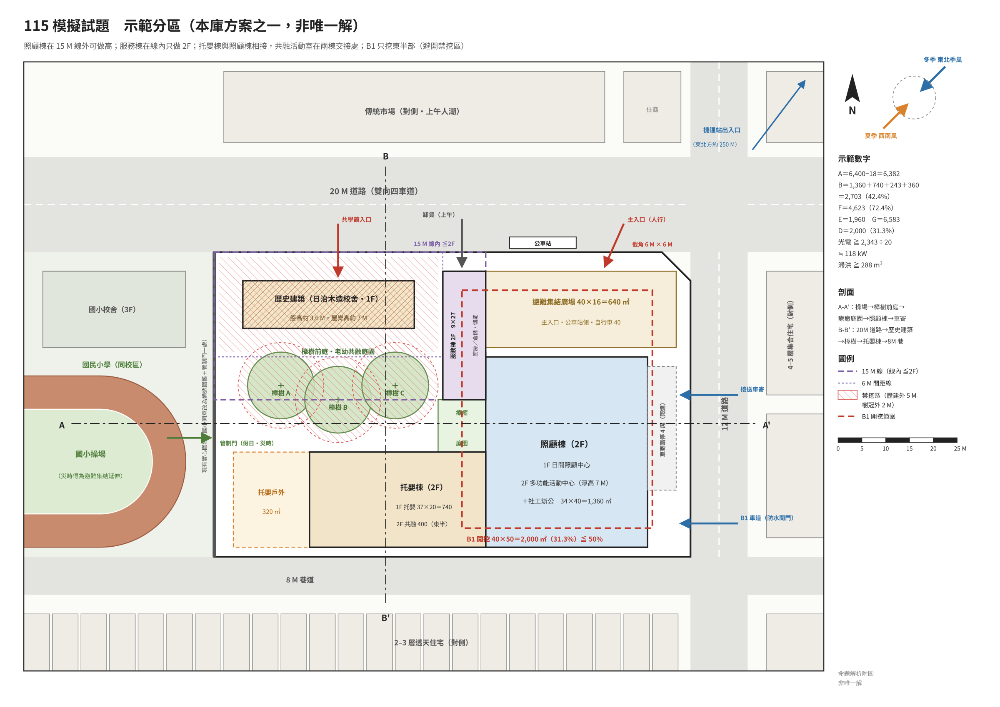

# 115 模擬試題｜命題解析（作答後再看）

> 對應試題：[115-模擬試題](./115-模擬試題.md)（列印：[PDF](./115-模擬試題.pdf)）。本庫自擬，**非官方試題**；示範數字是方案之一，**不是唯一正解**。
> 用法：先限時 4 小時作答 → 用 §6 自評表打分 → 再讀 §2 陷阱與 §3 算式，對照自己漏了哪裡。

---

## 1. 為什麼 115 可能這樣出（命題意圖）

| 趨勢 | 歷屆證據 | 本題落點 |
|------|---------|---------|
| 公共設施用地多目標、複合使用 | 113 市場＋社宅、114 停車場＋運動 | **學校用地 → 社會福利設施**（少子化 × 高齡化） |
| 韌性、平災兩用 | 111、113、114 申論連三年 | 避難收容＋物資＋儲能；淹水潛勢要抬高 |
| 開挖範圍必標 | 112–114 連續要求 | 這次**題目給上限 50%＋禁挖區**，考你會不會照題目而不是照習慣 |
| 一樓平面 | 113 明文要求 | 配置圖兼地面層平面 |
| 剛生效新制 | 太陽光電設置標準 115.8.1 施行 | 面積計算表要寫**裝置容量** |
| 歷史涵構＋老樹 | 106、107、111、112 | 歷史建築＋三株老樟樹＝英雄條件 |
| 微氣候 | 106 申論 | 熱島＋淨零：極端高溫正是長者與幼兒的災害 |

---

## 2. 題眼、英雄條件與十個陷阱

**英雄條件**：歷史校舍＋老樟樹前庭（場所記憶＋天然遮蔭）→ 主軸可寫「**樟樹前庭・老幼共融**」。
**第二資源**：國小操場（假日共享、災時避難延伸）。
**硬限制**：15 M 內 ≦2F、6 M 間距、開挖 ≦50%＋禁挖區、淹水 0.5 M、16:00 接送壅塞、西曬。

| # | 陷阱 | 正確處理 |
|---|------|---------|
| 1 | 基地面積直接寫 6,400 | **要扣截角**：100×64 − 6×6÷2 ＝ **6,382**（題目明寫截角不屬基地） |
| 2 | 只算新建量體 | 歷史建築 360 ㎡ **要進 B 與 F**（題目明寫） |
| 3 | 「以地面層為原則」當成「一定」或「隨便」 | 日照＋托嬰放 1F 是做得到的（見 §3）；但**多功能館（1,067）再放 1F 會到 3,428 > 3,191**，所以它必須上樓——放 2F 也剛好比較防淹 |
| 4 | 開挖套自己習慣的 60% | 題目給 **≦50%**，照題目；而且歷史建築外 5 M、樹冠外 2 M **不能挖**，地下室只能放東半部 |
| 5 | 剖面看不出 15 M 線 | 距歷史建築 15 M 內新建 ≦2F → **剖面要畫出高度退階**，並標 15 M 與 6 M |
| 6 | 地面抬高 0.5 M 只寫一句 | 0.5 M × 12 ＝ **坡長 6 M**（無障礙 1/12）＋上下平台；輪椅、嬰兒車、助行器都要走 → 做成地景坡道 |
| 7 | 物資倉儲、儲能放地下 | 題目禁止（淹水）→ 1F 抬高或 2F |
| 8 | 光電只畫面板不算容量 | 裝置容量 ≧ **新建**建築面積 ÷ 20（歷史建築不是新建）→ 見 §3 |
| 9 | 接送臨停放北側 20 M 道路 | 16:00 國小接送壅塞 → 改東側 12 M 道路側**車寄**（具雨遮） |
| 10 | 托嬰戶外兼避難廣場；學童穿越卸貨動線 | 題目明寫**不得重疊**；管制門接樟樹前庭（純人行），卸貨限上午、不穿越學童路線 |

---

## 3. 考場版算式（照 [24 §5](../24-容積與地下室計算法.md) 格式）

```
① A ＝ 100×64 − 6×6÷2 ＝ 6,400 − 18 ＝ 6,382〔題給尺寸計算〕
② B ≦ 3,191　F ≦ 12,764　D ≦ 3,191（開挖 50%，題給）
③ P 新建淨 ＝ 1,000＋500＋300＋800＋150＋200＋120 ＝ 3,070〔題給〕；歷史建築 360〔既有，計入〕
④ F 需求 ＝ 3,070÷0.75〔公設 25%，方案〕≒ 4,094 ＋ 360 ＝ 4,454
   量體 ＝ 照顧棟 1,360×2F＋托嬰棟 740＋400＋服務棟 243＋160＋歷史建築 360 ＝ 4,623 ≦ 12,764 …ok（36.2%）
⑤ B ＝ 1,360＋740＋243＋360 ＝ 2,703（42.4%）≦ 3,191 …ok〔日照、托嬰皆在 1F〕
⑥ E ＝ 汽 40×40＋機 60×3.5〔題給車數〕＋機電 150〔方案〕＝ 1,600＋210＋150 ＝ 1,960
⑦ G ＝ 4,623＋1,960 ＝ 6,583
⑧ D ＝ 40×50 ＝ 2,000〔方案・避開禁挖區〕≧ 1,960 → 31.3% ≦ 50% …ok
光電 ≧ (2,703−360)÷20 ＝ 2,343÷20 ≒ 117.2 → 118 kW〔屋頂約需 770 ㎡（每 kW 約 6.5 ㎡ 概估）〕
滯洪 ≧ 6,382×0.045 ≒ 287.2 → 288 m³（技則 §4-3）
```

**示範量體（樓層分配）**

| 棟 | 投影 | 1F | 2F | F |
|----|-----:|----|----|---:|
| 照顧棟（15 M 線外） | 34×40＝1,360 | 日間照顧中心 1,334 | 多功能活動中心 1,067（挑高，淨高 7 M）＋社工辦公 267 | 2,720 |
| 托嬰棟 | 37×20＝740 | 托嬰中心 667 | 共融活動室 400（東半，接照顧棟） | 1,140 |
| 服務棟（15 M 線內，≦2F） | 9×27＝243 | 共享廚房 200 | 物資倉儲・儲能 160 | 403 |
| 歷史建築（社區共學館） | 360 | 360 | — | 360 |
| **合計** | **2,703** | | | **4,623** |

> 各空間 ÷0.75 後無條件進位：日照 1,334、托嬰 667、共融 400、多功能 1,067、廚房 200、辦公 267、倉儲 160。
> 高度：照顧棟 FL＋0.5、1F 樓高約 4.2 M、2F 多功能館約 8.5 M（淨高 7 M＋結構），合計約 14.5 M ≦ 18 M、2 層 ≦ 4 層。
> ⚠️ 機車 3.5 ㎡ 是否列入免計、太陽光電標準條文細節，依 [24 §5](../24-容積與地下室計算法.md) 的待核標示處理；考場寫核算邏輯即可。

---

## 4. 示範分區（方案之一）



| 分區 | 位置 | 理由 |
|------|------|------|
| 避難集結廣場 640 ㎡ | 東北角（公車站、截角、往捷運方向） | 社區最容易到、主入口兼用；下方可為 B1 |
| 照顧棟 | 東側、15 M 線外 | 唯一能做大跨距與較高量體的區塊；日照 1F 西面朝療癒庭園與樟樹 |
| 托嬰棟 | 南側、樹冠保護範圍外 | 南向採光；西側 320 ㎡ 戶外活動空間鄰國小操場（通透圍籬） |
| 服務棟 | 歷史建築東側 6 M 外、15 M 線內 | 只做 2F；廚房 1F 供災時供膳，倉儲儲能在 2F 防淹 |
| 樟樹前庭（老幼共融庭園） | 歷史建築南側、三株樟樹下 | 遮蔭、場所記憶、共學館的戶外教室；管制門由此接操場 |
| B1 停車 40×50 | 東半部 | 避開歷史建築外 5 M 與樹冠外 2 M；車道接東側 12 M 道路並設防水閘門 |

**兩向剖面建議**
- **A-A'（東西，y≈36）**：國小操場 → 通透圍籬 → 樟樹前庭（樹冠） → 療癒庭園 → 照顧棟（1F 日照／2F 挑高多功能館） → 車寄 → 12 M 道路 → 集合住宅。標 FL＋0.5、B1、淨高 7 M。
- **B-B'（南北，x≈36）**：20 M 道路 → 退縮 4 M → 歷史建築（脊高 7 M） → 樟樹 C → 托嬰棟 → 退縮 2 M → 8 M 巷道 → 透天。標 15 M 線、6 M 間距。

---

## 5. 申論擬答骨架

**（一）熱島成因與對策（15 分）**
- 成因四點：人工鋪面蓄熱與反照率低；綠覆與蒸發散不足；空調與交通的人工排熱；街谷過深過密，長波輻射散不掉、風進不來。
- 對策分兩層畫成表：
  - **都市設計**：順季風留通風廊道、連續遮蔭綠網與騎樓遮簷、控制街道高寬比、涼適鋪面與高反射屋頂、藍綠基盤串連。
  - **敷地計畫**：配置留風道（本題夏季西南風由操場吹入）、保留喬木（三株樟樹）、西曬面遮陽與植栽、透水保水、設「涼適據點」（平災兩用）。
- 小圖：平面風向箭頭＋一張街道剖面（遮蔭、風、熱）。

**（二）淨零敷地作為（15 分）**
- 開頭一句：《氣候變遷因應法》（112 年公布）已將 2050 淨零入法，減碳要從敷地階段開始，不只是設備。
- 五面向，每項都落到本題：
  1. **配置與座向**：主要量體長軸東西、南向採光，西側以植栽與遮陽處理西曬。
  2. **通風與遮陽**：夏季西南風穿越樟樹前庭進入照顧棟，降低空調負荷。
  3. **再生能源**：照顧棟屋頂光電 118 kW＋儲能，災時供電＝平災兩用。
  4. **低碳交通**：捷運 250 M、公車站在門口、自行車 40 輛；汽車只設題給 40 輛，預留充電。
  5. **雨水與綠覆**：滯洪 288 m³ 回收澆灌沖廁；保留老樹＝不伐樹的碳匯。
- 加分句：**歷史建築活化再利用，是隱含碳最低的「建築」**。
- 小圖：本題基地的「淨零敷地圖」（光電、風、樹、雨水、交通五個圖示）。

---

## 6. 自評表（70 分設計題，本庫自訂，非官方配分）

| 項目 | 配分 | 檢核點（每項要有圖面證據） | 得分 |
|------|----:|--------------------------|----:|
| 基地回應 | 15 | 歷史建築、樟樹、國小操場、淹水、16:00 接送、西曬都有圖面回應 | |
| 配置與機能 | 20 | 日照、托嬰在 1F；共融室連通兩者；多功能館位置合理；平災兩用說得清楚 | |
| 動線 | 10 | 人車分道、東側車寄、卸貨、學童不穿越、避難動線、無障礙坡道 | |
| 開放空間 | 10 | 樟樹前庭、避難廣場 ≧600、托嬰戶外 ≧150 且不重疊、療癒庭園 | |
| 剖面與透視 | 10 | 15 M 退階、FL＋0.5、B1、淨高 7 M、透視有人物（長者＋幼兒） | |
| 計算與法規 | 5 | A 扣截角、B 與 F 含歷史建築、D ≦50%、光電 kW、滯洪 m³ | |
| **合計** | **70** | | |

**交卷前五問**：A 扣截角了嗎？歷史建築進 B、F 了嗎？開挖有沒有超過 50%、有沒有挖到禁挖區？15 M 線有畫在剖面上嗎？光電容量寫了嗎？
