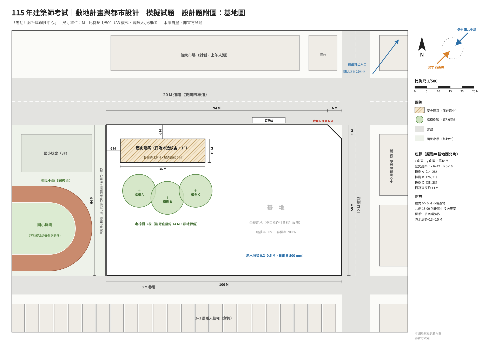

# 115 年建築師考試｜敷地計畫與都市設計　模擬試題

> 本庫自擬之模擬題，**非官方試題**；題型、配分與圖說要求比照 106–114 年（申論 30＋設計 70）。
> 建議限時 4 小時作答，寫完再看 [命題解析](./115-模擬試題-命題解析.md)。
> 列印用：[`115-模擬試題.pdf`](./115-模擬試題.pdf)（A4 試題 3 頁＋A3 原寸基地圖 1/500）。

| 項目 | 內容 |
|---|---|
| 等　別 | 高等考試 |
| 類　科 | 建築師 |
| 科　目 | 敷地計畫與都市設計 |
| 考試時間 | 4 小時 |

※注意：
- （一）可以使用電子計算器。
- （二）不必抄題，作答時請將試題題號及答案依照順序寫（繪）於試卷（圖紙）上，於本試題上作答者，不予計分。
- （三）本科目除專門名詞或數理公式外，應使用本國文字作答。

---

## 一、申論題（30 分）

極端高溫日益頻繁，長者與幼兒因體溫調節能力較弱，是熱危害的高風險族群；同時，我國已宣示 2050 年淨零排放目標。請回答下列問題：

（一）說明都市熱島效應形成的主要原因，並分別從「都市設計」與「敷地計畫」兩個層面，提出降低戶外熱危害、改善行人熱舒適的具體策略。（15 分）

（二）公共建築應如何在敷地計畫階段即降低營運與交通的碳排放？請就基地配置與座向、自然通風與遮陽、再生能源（如屋頂太陽光電）、低碳交通、雨水利用與綠覆等面向，以圖文方式說明，並以本次設計題基地為例。（15 分）

---

## 二、設計題（70 分）：「老幼共融社區韌性中心」規劃設計

### （一）計畫緣起

某都市國民小學因少子化減班，校地東北隅之舊校舍區長年閒置。市政府擬將此區劃為獨立基地，興建「老幼共融社區韌性中心」，整合長照日間照顧、公共托育、代間共學與社區共餐；平時為社區照顧與交流據點，災時（地震、水患、極端高溫）作為社區避難收容及物資據點，以實踐「平災兩用」。

基地內有日治時期木造校舍一棟，已登錄為歷史建築，應保存並活化為「社區共學館」；校舍南側三株老樟樹應原地保留。

### （二）基地概述（詳附圖）

1. 基地東西 100 M、南北 64 M，東北角臨路口設有 6 M × 6 M 截角（截角部分不屬基地）。
2. 使用分區為學校用地，已依都市計畫公共設施用地多目標使用相關規定核准作社會福利設施使用（本題假設條件）；建蔽率 50%、容積率 200%。
3. 北臨 20 M 道路（雙向四車道，基地前設有公車站，對側為傳統市場）；東臨 12 M 道路（對側為 4–5 層集合住宅）；南臨 8 M 巷道（對側為 2–3 層透天住宅）；西鄰同一校區之國民小學（西北側為 3 層校舍、西南側為操場）。基地東北方約 250 M 為捷運站出入口。
4. 國小放學時段（16:00 前後），北側 20 M 道路接送車輛壅塞。基地與國小交界現為實心圍牆，國小同意改設通透圍籬並設管制門一處，假日開放社區通行，災時操場得作為避難集結之延伸空間；國小學童不得穿越本中心之車行及服務動線。
5. 歷史建築：木造平房一棟，長 36 M、寬 10 M（樓地板面積 360 ㎡），簷高約 3.6 M、屋脊高約 7 M，位置如附圖。不得拆除，亦不得於其上增建；其建築面積及樓地板面積應計入本基地建蔽率及容積率檢討。
6. 老樟樹 3 株：胸徑約 80–110 cm，樹冠直徑約 14 M，位置如附圖；樹冠投影外 2 M 範圍內不得設置建築物、不得開挖。
7. 地勢平坦；基地位於淹水潛勢區（日雨量 500 mm 時淹水深度約 0.3–0.5 M）。
8. 氣候：夏季盛行西南風、冬季東北季風；夏季午後西曬強烈，年日照時數約 2,000 小時。

### （三）都市設計準則（本題給定）

1. 臨 20 M 道路退縮 4 M、臨 12 M 道路退縮 3 M、臨 8 M 巷道退縮 2 M，均留設無遮簷人行道。
2. 新建建築物高度不得超過 4 層且不得超過 18 M；距歷史建築外牆 15 M 範圍內之新建建築物不得超過 2 層；新建建築物與歷史建築外牆之距離不得小於 6 M。
3. 地下室開挖率不得超過 50%；歷史建築外牆外 5 M 範圍內不得開挖。
4. 地面層樓板應高於前面道路路面 0.5 M 以上，或設置同等效能之防洪措施；地下室出入口應設防水閘門。
5. 屋頂應設置太陽光電發電設備，並於圖面標示設置範圍及裝置容量（依現行規定檢討）。
6. 基地內應設置雨水貯集滯洪設施，並標示位置及容量（依建築技術規則檢討）。

### （四）計畫內容

> 面積為各空間之淨面積，不含門廳、走廊、樓電梯、廁所、機電等公共設施；公共設施比例自訂並說明。

| 項目 | 面積／數量 | 說明 |
|---|---|---|
| 1. 日間照顧中心 | 1,000 ㎡ | 失能、失智長者 60 人；含活動區、休憩室、餐廳及備餐、復健、沐浴、護理站及辦公；以設於地面層為原則，並應有專用療癒庭園 |
| 2. 公共托嬰中心 | 500 ㎡ | 0–2 歲幼兒 40 名；以設於地面層為原則；專用戶外活動空間 ≥ 150 ㎡ |
| 3. 老幼共融活動室 | 2 間，共 300 ㎡ | 代間共學、共餐、親子活動；應與日間照顧中心及托嬰中心便捷連通 |
| 4. 多功能活動中心 | 800 ㎡ | 平時供社區運動與集會（可設羽球場 2 面），災時作為避難收容空間（收容 250 人）；室內淨高 ≥ 7 M |
| 5. 社區共學館 | 360 ㎡（歷史建築） | 社區大學教室及地方記憶展示；應與老樟樹共同形成戶外核心 |
| 6. 社區共享廚房 | 150 ㎡ | 供平日共餐及災時供膳；須有獨立卸貨動線 |
| 7. 社工站及管理辦公 | 200 ㎡ | 含個案諮詢、志工室、中控室 |
| 8. 防災物資倉儲及緊急電力 | 120 ㎡ | 含儲能設備；不得設於地下層 |
| 9. 公共設施 | 自訂 | 門廳、廁所、樓電梯、機電等；全區無障礙，應設無障礙電梯 |
| 10. 停車 | — | 汽車 40 輛（含無障礙車位 2 輛）、機車 60 輛，設於地下層；長照及托育接送臨停 4 席設於地面層並具遮雨設施；自行車 40 輛 |
| 11. 戶外空間 | — | 避難集結廣場 ≥ 600 ㎡（不得與托嬰戶外活動空間重疊）、療癒庭園、雨水貯集滯洪設施、景觀綠化 |

### （五）圖說要求

1. 規劃構想說明：以圖文表達基地分析、課題與對策及配置概念。
2. 全區配置圖兼地面層平面圖（比例尺 1/300 或 1/400，自選）：應標示主、次出入口及人車動線（含長照與托育接送、卸貨、汽機車出入口）、地下室開挖範圍及開挖率、歷史建築與老樟樹之保護範圍、避難集結廣場與避難動線、托嬰戶外活動空間、療癒庭園、滯洪設施位置及無障礙通路。
3. 全區空間機能組織圖（含水平及垂直關係）。
4. 剖面圖至少 2 向：應表示樓層數、高度、地下室、地面層防洪高程，以及與歷史建築、國小之關係。
5. 外部空間局部透視圖至少 1 處（含歷史建築、老樟樹與老幼共融庭園）。
6. 面積計算表：基地面積、建築面積及建蔽率、總樓地板面積及容積率、地下開挖面積及開挖率、太陽光電裝置容量。

### 附圖：基地圖

> 尺寸單位 M。座標原點為基地西北角（x 向東、y 向南）：歷史建築 x 6–42、y 6–16；樟樹 A（14, 28）、B（26, 31）、C（38, 28），樹冠直徑約 14 M。A3 原寸（1/500）見 PDF 最後一頁。
